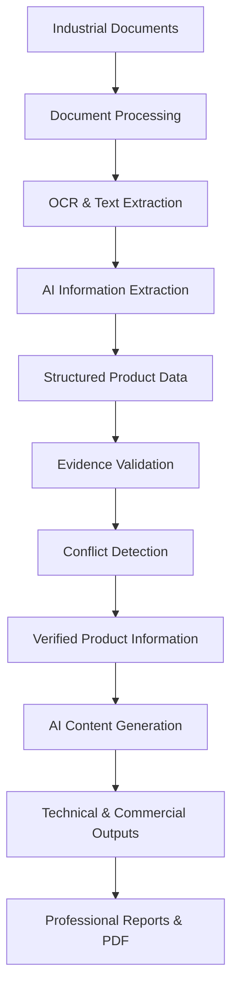

# 🏭 SANATNEGAR v2.0 | AI-Powered Industrial Intelligence

<div align="center">


### From Technical Documents to Business-Ready Content

**An intelligent platform for extracting, validating, reconciling, and transforming industrial product information into reliable technical and commercial content, powered by AI and traceable evidence.**

<br/>


</div>

---

## 🚀 Overview

**SANATNEGAR** is an AI-powered industrial intelligence platform designed to turn complex technical documents into structured, verified, and commercially valuable product information.

It bridges the gap between raw industrial documentation and practical business communication by combining document processing, intelligent data extraction, evidence-based validation, conflict detection, and AI-assisted content generation.

Instead of relying on unsupported assumptions or fragmented product information, SANATNEGAR builds content around verifiable technical sources and traceable evidence.

### Core Capabilities

- 📄 **Intelligent Document Processing** — Extract information from industrial documents, datasheets, catalogs, and technical PDFs.
- 🔍 **AI-Powered Data Extraction** — Identify product specifications, technical parameters, attributes, and structured information.
- ✅ **Evidence-Based Validation** — Validate extracted information against source documents and supporting evidence.
- ⚖️ **Conflict Detection & Reconciliation** — Identify contradictory specifications across multiple documents and sources.
- 🔗 **Traceable Evidence** — Maintain connections between extracted data, source documents, and supporting references.
- ✍️ **AI Content Generation** — Generate technical descriptions, product profiles, commercial content, and structured product information.
- 📑 **Professional PDF Export** — Produce structured, presentation-ready reports and documents, including Persian-compatible PDF output.
- 🗂️ **Document Management** — Organize uploaded files, processed documents, generated content, and project data.
- 🛡️ **Secure Architecture** — Keep uploaded files and application data within a controlled storage environment.

---

## 🧠 How It Works

SANATNEGAR transforms industrial documentation into actionable information through an intelligent processing workflow:



### Processing Pipeline

| Stage | Description |
|---|---|
| **1. Document Input** | Upload technical documents, datasheets, catalogs, and supporting files. |
| **2. Processing & OCR** | Extract text and information from supported document formats. |
| **3. Intelligent Extraction** | Identify specifications, product attributes, values, units, and technical characteristics. |
| **4. Evidence Validation** | Verify extracted information against available source evidence. |
| **5. Conflict Analysis** | Detect inconsistencies, conflicting values, and discrepancies between sources. |
| **6. Information Consolidation** | Organize validated information into structured product records. |
| **7. Content Generation** | Generate technical and commercial content based on validated data. |
| **8. Export & Delivery** | Export professional reports and PDF documents. |

---

## 🏗️ Architecture

SANATNEGAR is built around a modular architecture designed to support document processing, intelligent analysis, data management, and content generation.

```text
SANATNEGAR/
│
├── frontend/
│   ├── Modular Persian RTL Interface
│   ├── HTML5
│   ├── CSS3
│   └── Vanilla JavaScript
│
├── backend/
│   ├── Express Server
│   ├── Authentication & Authorization
│   ├── Document Processing
│   ├── OCR Engine
│   ├── AI Extraction
│   ├── Evidence Validation
│   ├── Conflict Detection
│   ├── Content Generation
│   └── PDF Generation
│
├── storage/
│   ├── Private Uploaded Files
│   ├── PDF Catalogs
│   ├── Backups
│   └── SQLite Database
│
├── tests/
│   ├── Unit Tests
│   └── Integration Tests
│
├── docs/
│   ├── Audit Reports
│   ├── Architecture Documentation
│   ├── API Documentation
│   ├── Deployment Guide
│   └── Quality Checklist
│
├── .env.example
├── package.json
└── README.md
```

---

## 🛠️ Technology Stack

### Backend

- **Node.js 20+** — Runtime environment
- **Express.js** — Web application and API framework
- **SQLite** — Lightweight relational database
- **JavaScript** — Application logic and processing pipeline

### Frontend

- **HTML5** — Application structure
- **CSS3** — Responsive UI and visual design
- **Vanilla JavaScript** — Interactive application functionality
- **RTL Support** — Persian-first interface and right-to-left layout

### Document Processing

- **OCR** — Text extraction from scanned and image-based documents
- **PDF Processing** — Document parsing and report generation
- **Python 3** — Optional PDF rendering and processing support
- **WeasyPrint** — Professional PDF generation and layout
- **PDFKit** — Fallback PDF generation engine

---

## 📋 Requirements

| Dependency | Version | Required |
|---|---|---|
| Node.js | 20 or higher | ✅ Yes |
| npm | Compatible with Node.js | ✅ Yes |
| Python | Python 3 | ⚪ Optional |
| WeasyPrint | Compatible version | ⚪ Recommended |

Python and WeasyPrint are recommended for professional PDF rendering, particularly for Persian text, RTL layouts, and typography.

If they are unavailable, the application falls back to its internal PDFKit-based rendering engine.

---

## ⚡ Installation & Setup

### 1. Clone the Repository

```bash
git clone <repository-url>
cd SANATNEGAR
```

### 2. Install Dependencies

```bash
npm install
```

### 3. Configure Environment Variables

Create your environment configuration file:

```bash
cp .env.example .env
```

Edit `.env` and configure the required settings.

### 4. Initialize the Database

```bash
npm run migrate
```

This initializes the SQLite database and required tables.

### 5. Load Demo Data (Optional)

```bash
npm run seed:demo
```

This loads the demonstration scenario and sample data.

### 6. Start the Application

```bash
npm start
```

Open your browser and navigate to:

```text
http://localhost:3000
```

---

## 🔐 Security & Deployment

### Development Mode

During development, the application may operate with demo functionality enabled:

```env
DEMO_MODE=true
```

The default demo username is:

```text
admin
```

The default demo password is defined in `.env.example`.

A demonstration quick-login feature may also be available in demo mode.

### Production Deployment

Before deploying to a public environment, ensure the following:

```env
NODE_ENV=production
DEMO_MODE=false
AUTH_SECRET=<strong-random-secret>
```

**Security recommendations:**

- Disable demo mode in production.
- Replace all default credentials.
- Use a strong, randomly generated authentication secret.
- Never commit `.env` files or credentials to version control.
- Protect uploaded documents and private storage.
- Restrict access to sensitive files and generated reports.
- Configure secure session and authentication settings.
- Use HTTPS in production.
- Maintain regular database and file backups.

---

## 🧪 Testing

Run the automated test suite:

```bash
npm test
```

The test suite includes unit and integration tests covering supported application functionality.

```text
tests/
├── unit.test.js
└── integration.test.js
```

---

## 📑 Documentation

Additional documentation is available in the `docs/` directory.

| Document | Description |
|---|---|
| Audit Report | Application review and findings |
| Architecture | System components and design |
| API Documentation | Backend endpoints and interfaces |
| Deployment Guide | Installation and production setup |
| Quality Checklist | Validation and readiness checklist |

---

## 🎯 Vision

SANATNEGAR aims to make industrial information more reliable, accessible, structured, and commercially useful.

By combining AI with source-based verification, the platform helps reduce manual document analysis, improve information consistency, minimize unsupported claims, and accelerate the transformation of industrial knowledge into professional business content.

### From raw documents to verified knowledge.
### From verified knowledge to intelligent content.
### From intelligent content to industrial value.

---

<div align="center">

**SANATNEGAR v2.0**

*Industrial Intelligence. Verified Evidence. AI-Driven Content.*

</div>

